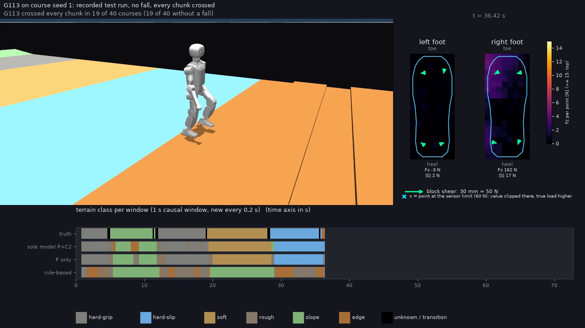
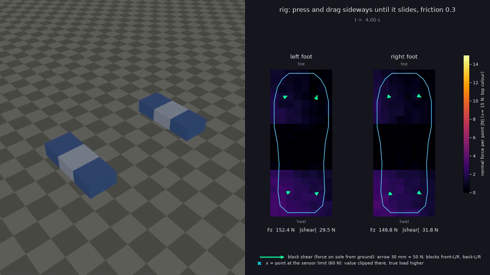

# Terrain from Touch

FLA step 1 · Booster K1 · 15 Nov 2026

Can a sensing sole tell the robot what it is standing on? A classifier trained and tested in simulation on the K1, with three different walking gaits.

> **Simulation only.** Nothing here comes from the real sole yet.

The full version with every result and all videos: [`results/summary_en.html`](results/summary_en.html) or visit [GitHub Pages](https://kyk0.github.io/terrain-from-touch/).

## In short

1. **Terrain classification works in simulation.** Six ground types, 0.89 F1 with the sole against 0.82 from joints and IMU alone.
2. **The sole helps most with support, not with terrain type.** Knowing whether each foot is in the air, half on an edge or fully supported goes from 0.76 to 0.93. A lifted robot is noticed in 0.1 s instead of 0.3 s.
3. **The sole alone is almost as good as sole plus joints.** Pressure map and shear with no joints at all: 0.88.
4. **A sole-only classifier carries over to a new gait; one that uses joints does not.** On a gait it never saw (SONIC): 0.53 against 0.07.
5. **Shear adds little on a familiar gait.** Joints and IMU already see a slipping foot (0.95). Shear does seem to help when the gait changes; that is being re-checked.
6. **The simulator cannot settle the questions about fine detail.** How force spreads under a rigid foot is not something it gets right. That needs a short recording from the real sole.

## What was built

- A simulated sole on the K1 in MuJoCo: 19 × 8 pressure points per foot and four shear vectors per foot (front and back, left and right halves).
- Six ground types: grippy, slippery, soft, rough, sloped, and plank edges with gaps. Plus a "lifted" case.
- Three gaits: two velocity policies (G113, G80) and SONIC-K1 playing human walking clips.
- A dataset of 6139 episodes, 33 hours, with labels for ground type, friction, stiffness and the support state of each foot.
- A small classifier that only reads signals. It does not control the robot.

One minute across a mixed course: [`course_g113_seed001.mp4`](results/v2/videos/course_g113_seed001.mp4). The strips under the video fill in as the robot walks: the true ground, then what three detectors say. "Sole model" reads the sole and joints, "P only" reads joints and IMU, "rule-based" is hand-written thresholds with no learning. The panel on the right is the simulated sole: color is pressure, arrows are shear.

## What the sole adds

| Input | Ground type, six classes (F1) | Support state per foot (F1) |
|---|---|---|
| Joints + IMU | 0.82 | 0.76 |
| + 4 pressure blocks | 0.83 | 0.81 |
| + pressure map | 0.88 | 0.93 |
| + pressure map + shear | 0.89 | 0.94 |
| Sole only, no joints: pressure map | 0.86 | 0.92 |
| Sole only, no joints: pressure map + shear | 0.88 | 0.93 |
| Sole only, no joints: shear alone | 0.79 | 0.75 |

Support state means: foot in the air, partly on an edge, or fully supported. This is the part that matches the two failure videos: stepping off the stage, and being lifted while the policy keeps "walking".

| Event | Joints + IMU | With the sole |
|---|---|---|
| Robot lifted off the ground: time to notice | 0.30 s | 0.10 s |
| Foot rests on an edge for 0.3 s or longer: missed | 37 % | 2 to 3 % (pressure map) |
| Mixed course: correct ground type, share of time | 0.79 | 0.84 |
| Mixed course: hand-written rules, no learning | 0.31, half of the ground changes missed | |

Lifted mid-walk: [`lifted_mid_walk_g113.mp4`](results/videos/lifted_mid_walk_g113.mp4). Forces on the sole drop to zero and the model reports both feet in the air. This clip is from the first version of the sole (eight zones per foot).

## A new gait breaks models that use joints

Each model was trained on two gaits and tested on the third. Models that read joints learn the gait as much as the ground. A model that reads only the sole keeps working.

| Tested on a gait not seen in training (ground type F1) | Sole + joints | Sole only |
|---|---|---|
| Average over the three gaits | 0.53 | 0.63 |
| SONIC (human-like, heel to toe) | 0.07 | 0.53 |

On a gait it was trained on, the same models score 0.84 to 0.91. This supports treating the sole and its model as one unit that does not depend on the robot's controller.

## Shear

- **On a familiar gait it adds 1 to 3 points.** In steady walking the horizontal force under the foot is set by how the robot accelerates, not by the floor. Joints and IMU predict it almost completely.
- **A slippery floor is visible without the sole.** When the foot slides, the joints show it: 0.95 F1 for grippy against slippery from joints and IMU alone.
- **On a new gait it seems to matter more.** In sole-only models, adding the four shear vectors raised the score on an unseen gait by 6 points with the pressure map and 12 with four pressure blocks. This was an exploratory finding and needs a dedicated re-check.
- **It clearly helps when the foot is dragged on purpose,** the way a person tests ice with a toe.

Foot pressed down and dragged sideways until it slides, friction 0.3: [`rig_drag03.mp4`](results/v2/videos/rig_drag03.mp4). Front and back carry the load, the middle reads nothing, and the four arrows show shear per block.

## What not to trust yet

- **How force spreads under the foot.** The simulated foot is a rigid box. The simulator gets the total force and its centre right, but not the pattern across the sole. While walking, the load sits in the corners, which a real sole would not show.
- **The advantage of the fine pressure map.** It disappears when the sole is modelled differently: a model trained on one version scores 0.20 to 0.27 on another. Models that use four pressure blocks hold up better (0.59 to 0.76).
- **Anything about sand, gravel, grass or carpet.** The simulator models properties (slippery, soft, uneven), not materials.
- **The walking itself.** No gait crossed the full mixed course in more than about half of the runs. Runs were scored up to the fall.

## Real-world validation requirements

- PaXini sole documentation, SDK or simulation examples: pressure and shear channels, point layout, ranges, and adapter requirements.
- A 15 to 30 minute recording on the K1: standing, manual loading, and walking on two or three surfaces.
- The identity of the walking controller used during recording.

## Where this can go next

- **The sole as a teacher for vision.** The robot looks, steps, and the sole says what the ground was. Those labels train a vision model to predict it before the step. This is the bridge to the VLM stage.
- **A learned sensor model.** With a short real recording, train a small model that turns what the simulator computes correctly into a realistic sole reading. That fixes the main weakness above.
- **How much sole is needed.** A check is running on how accuracy changes from 4 to 152 pressure points and with or without shear, to see what a simpler sole would lose.

## Where things are

| What | Where |
|---|---|
| Full report, second run | [`results/REPORT_V2.md`](results/REPORT_V2.md) |
| Full report, first run | [`results/REPORT.md`](results/REPORT.md) |
| All videos | `results/videos/` (first run), `results/v2/videos/` (second run) |
| Code | `fla-terrain/` |

Numbers are from the second simulation run: test split, walking, mean of three training runs, three gaits. The dataset and trained models are on the lab servers.
